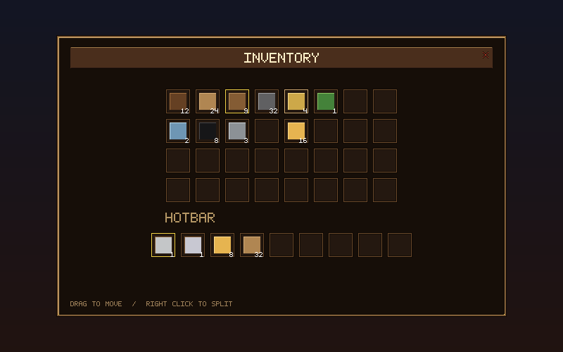
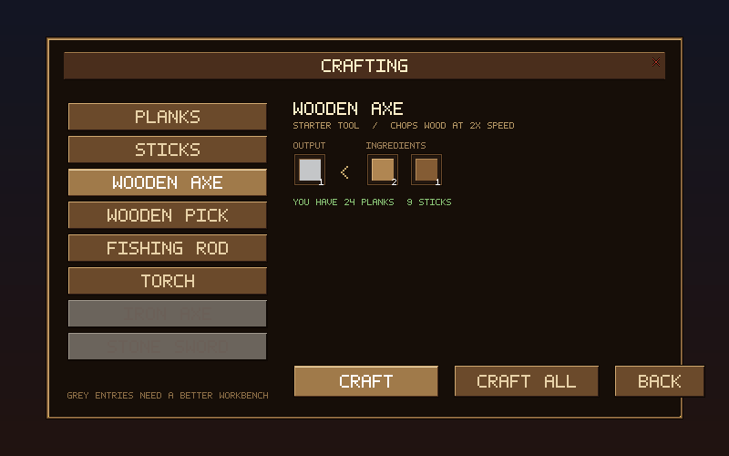
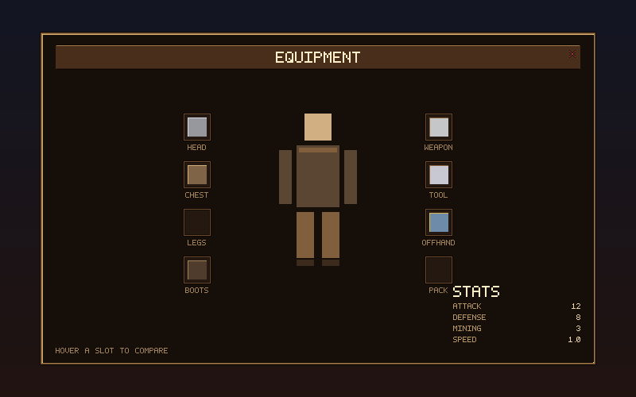
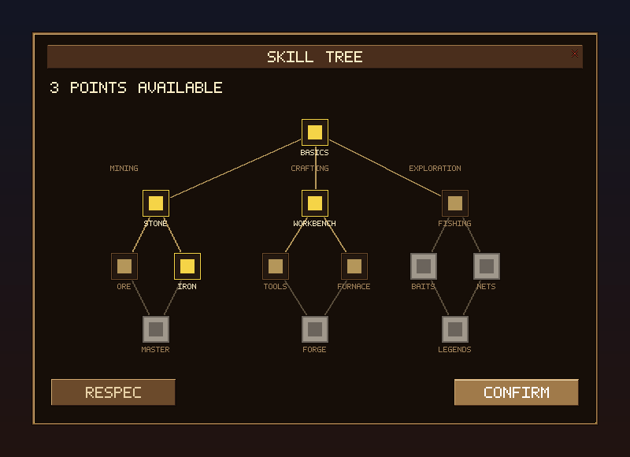

# Crafting, mining, clutter, tools, fishing

Living design doc for the gameplay loop that starts with "walk up to a
tree, chop it, get a log" and ends with "fish appears in your inventory
because you spent a sunset standing on a pier with a wooden rod". Lives
alongside `plan.md`, `plan-voxel-lighting.md`, and `water.md`; the same
"plan first, port second" pattern.

The visual layer this rides on is already in tree: `src/client/pixel_ui.c`
draws nine-sliced pixel-art panels, buttons, and inventory slots backed
by a single swappable atlas (`assets/textures/ui/default.png`, baked by
`tools/gen-ui-sprites.py`, layout described in
`assets/config/ui.yaml`). The mockups below are composed from that same
atlas via `tools/gen-ui-mockups.py` so they reflect what the in-game
screens will actually look like when the gameplay backing each panel
lands.

---

## Mockups

### Inventory



8 x 4 main grid + a 9-slot hotbar row, each cell using the slot sprite
(four states: normal, hover, selected, disabled). The selected stick
slot shows the gold accent, the ore slot shows the bronze hover ring,
the disabled state is reserved for "you can't pick that up yet" cases
like recipe-filter overlays. The two example tools in the hotbar
(axe, pickaxe) read as item icons, not block icons - the inventory
needs to hold items as well as blocks, which is foundation work
(see below).

### Crafting



Two-pane layout: vertical recipe list on the left (the highlighted row
uses the hover sprite to read as "current selection"), recipe detail on
the right with an output slot, input slots, an arrow, and CRAFT /
CRAFT ALL / BACK action buttons. Disabled recipes use the greyed-out
button sprite. Each entry in `recipes.yaml` becomes one row here.

### Equipment



Centre figure flanked by HEAD / CHEST / LEGS / BOOTS on the left and
WEAPON / TOOL / OFFHAND / PACK on the right - empty slots stay
recessed so a hand-painted item sprite would pop the moment it's
equipped. Right-edge STATS readout sums the modifiers from every
equipped piece. The figure itself is a stand-in for the eventual
character mesh.

### Skill tree



Three branches (Mining, Crafting, Exploration) radiating from a root
node. Each node is a small slot - selected nodes use the gold accent,
locked nodes use the disabled sprite, links between nodes are drawn
as direct line segments behind the slots. The "points available"
counter and bottom-row RESPEC / CONFIRM buttons live in the same UI
layer as the rest.

---

## Vertical-slice plan

These ship in order on a single branch
(`claude/crafting-mining-resources-*`). The loop closes at step 9:
chop tree -> log -> planks -> sticks -> axe -> rod -> fish. Each step
is a PR-sized commit; the foundation steps land first so later visible
features have somewhere to plug in.

### 1. Item types (foundation, no UI change yet)

Today `inv_slot_t` in `src/client/inventory.h:14` only holds block
ids. Crafting needs the inventory to hold sticks, planks, fish, and
tools too - none of which are blocks.

- Add `enum item_kind { ITEM_KIND_BLOCK, ITEM_KIND_RESOURCE, ITEM_KIND_TOOL }`.
- Add `enum item_id { ITEM_NONE, ITEM_LOG, ITEM_PLANK, ITEM_STICK,
  ITEM_AXE_WOODEN, ITEM_ROD_WOODEN, ITEM_FISH_COMMON, ... }`.
- Widen `inv_slot_t` to `{ kind, id, count, durability }`. Blocks keep
  working through their existing path.
- Extend the hotbar UI to render item icons (sampled from an item
  atlas) alongside block icons.

### 2. Tree collider matches the slim visual

The visual already shows narrow trunk + canopy voxels (the
`partial_width` flag is set in `src/core/blocks.c:26`), but the
collision path still treats wood + leaves as full cells. The fix is
to consult the existing flag during collision and substitute a slim
inscribed-hex collider. Lives in `core/` so SP and MP share it. Radius
scale becomes one knob in `world.yaml`.

### 3. Pixel-art -> 3D pipeline (`tools/gen-pixel-mesh.py`)

PNG in, `.obj` out under `assets/models/items/`, JSON sidecar with
`{pivot, grip}`. Each opaque pixel extrudes to a thin box; matching
neighbours merge into runs to keep tri-count low. Deterministic,
stdlib + zlib only (same constraint as every other generator under
`tools/`).

First asset: hand-author `assets/sprites/items/axe_wooden.png`, bake
`axe_wooden.obj`. A tiny `.obj` loader joins `client/` if there isn't
one already.

### 4. Ground clutter layer (sticks only to start)

New `src/core/clutter.{c,h}`, storing one byte per column the same way
torches are stored. MP write-through via `saves_write_clutter()`, SP
through `persistence_save_clutter()` - same-frame writes per the
CLAUDE.md persistence rule.

- World gen drops sticks on ~3% of grass tiles (density in
  `clutter.yaml`).
- Rendered as a billboarded sprite (no mesh) until we want more
  clutter kinds.
- Break with anything -> `ITEM_STICK` into the inventory.

### 5. Drop table (`assets/config/drops.yaml`)

The break path in `src/client/interact.c:280` currently just calls
`inventory_add(block_type)` - changing it to a `drops_resolve(block,
tool)` lookup centralises every "what falls out of this block when
you hit it" decision.

```yaml
wood:
  with: axe       -> { item: log,   count: 1 }
  with: hand      -> { delay_mult: 8.0 }   # slow, no drop
leaves:
  with: any       -> { item: stick, count: 1, chance: 0.25 }
stone:
  with: pickaxe   -> { item: stone, count: 1 }
```

### 6. Held-tool renderer (`src/client/held_item.c`)

Draws the equipped tool's `.obj` lower-right of the camera, swings on
use. Reads the grip pivot from the JSON sidecar baked alongside the
mesh in step 3. Hotbar icons sample the same sprite the mesh was
baked from - one source of truth per item, no separate icon art.

### 7. Workbench + crafting UI

- New `BLOCK_WORKBENCH`, placeable like any block.
- Interact opens the crafting panel from the mockup above
  (`src/client/crafting_ui.c`).
- `recipes.yaml`:

```yaml
- output: { item: plank,        count: 4 }
  ingredients: [{ item: log, count: 1 }]
  station: workbench

- output: { item: stick,        count: 4 }
  ingredients: [{ item: plank, count: 2 }]
  station: workbench

- output: { item: axe_wooden,   count: 1 }
  ingredients: [{ item: plank, count: 2 }, { item: stick, count: 1 }]
  station: workbench

- output: { item: rod_wooden,   count: 1 }
  ingredients: [{ item: stick, count: 2 }, { item: plank, count: 1 }]
  station: workbench
```

### 8. Fishing

- Hold a rod, click on water -> bobber spawns at the hit tile.
- Timer drawn from `fishing.yaml`'s per-biome catch table.
- On bite, click again -> `ITEM_FISH_COMMON` to inventory.

### 9. First baked fish

Hand-author `assets/sprites/items/fish_common.png` (side view), bake
to `fish_common.obj` through the pipeline from step 3. The same mesh
drives the hotbar icon, the wiggling fish on the hook, and the
eventual cooked-fish item - one asset, three uses.

---

## UI module reference

`src/client/pixel_ui.h` is the entry point. The screens above each
become a single `*_ui_draw()` function that:

1. Opens with `pixel_ui_begin()`.
2. Lays out `pixel_ui_panel`, `pixel_ui_title_bar`, `pixel_ui_button`,
   `pixel_ui_slot`, `pixel_ui_label` calls.
3. Closes with `pixel_ui_end()`.

Hot / active state is tracked per-frame by pointer identity on the
caller's `id` string, so two widgets with the same id act as one
logical widget. Mouse + touch events are pumped through
`pixel_ui_event()` from `main_web.c`'s central event handler before
the input layer gets a chance, so widgets can swallow clicks.

### Themes

`assets/config/ui.yaml` lists each sprite's atlas rect + nine-slice
margins. Swap the PNG and the YAML in lockstep and every widget call
in the codebase renders the new theme - no C changes required. The
compiled-in defaults in `src/core/config.c` mirror the shipped atlas
so a missing YAML is non-fatal.

### Iterating on the art

```sh
# Regenerate the atlas from the Python builder
python3 tenebris-c/tools/gen-ui-sprites.py

# Refresh the mockups in this doc
python3 tenebris-c/tools/gen-ui-mockups.py
```

Both scripts are deterministic stdlib + zlib only - no PIL, no Node,
nothing to install. Commit the regenerated PNGs alongside the script
change so the doc and the runtime atlas stay in lockstep.

### Running the demo in-engine

Boot the WASM build, press `F8`. A demo panel exercises every widget
(panel, four button states, four slot states, title bar, close X)
over the live scene - useful for sanity-checking that the atlas
loaded, the nine-slice math is right, and hot/active reactions feel
correct before any real inventory wiring exists.
